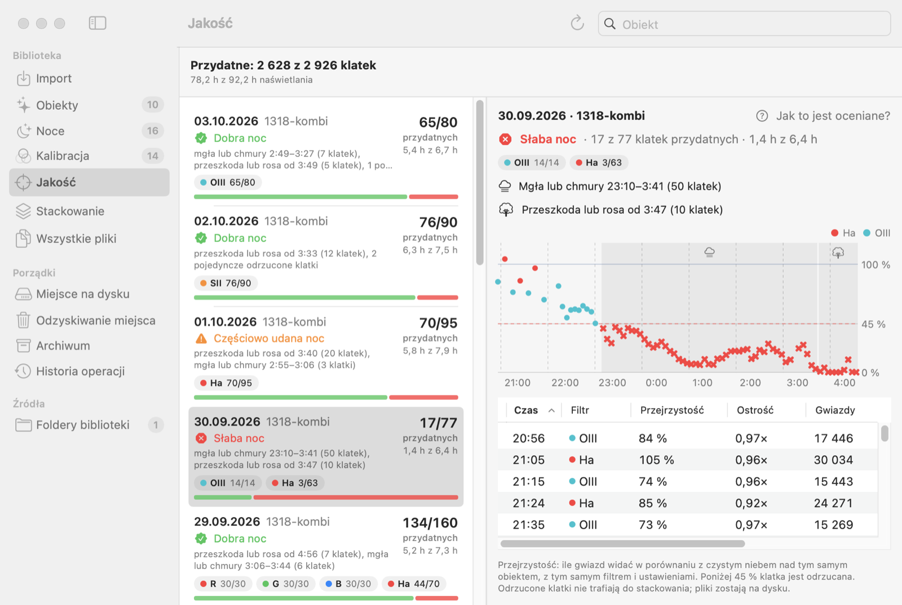
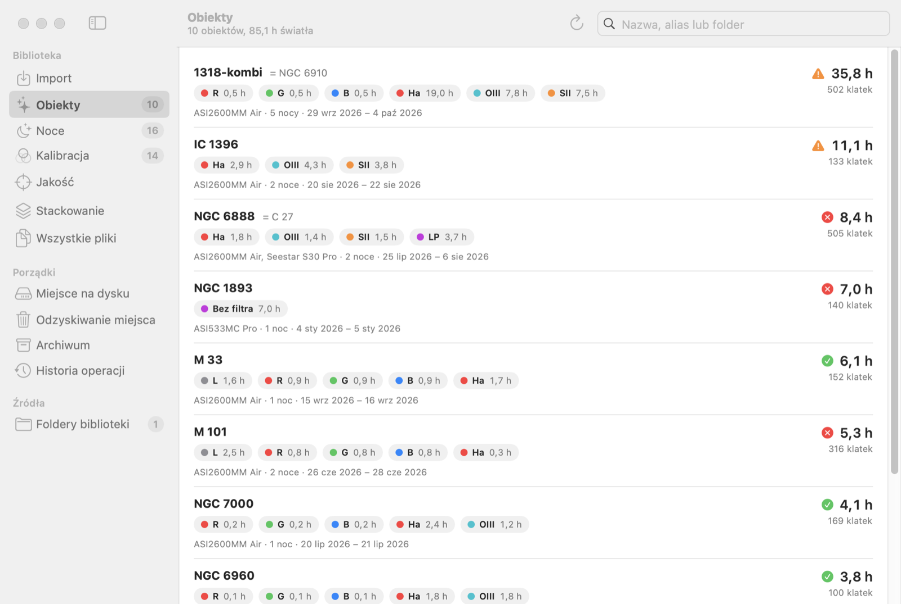
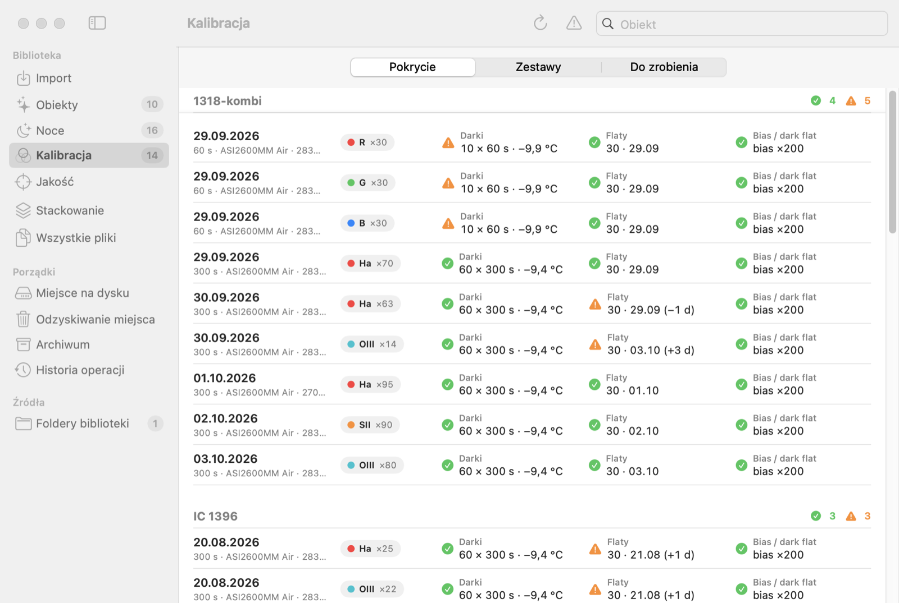
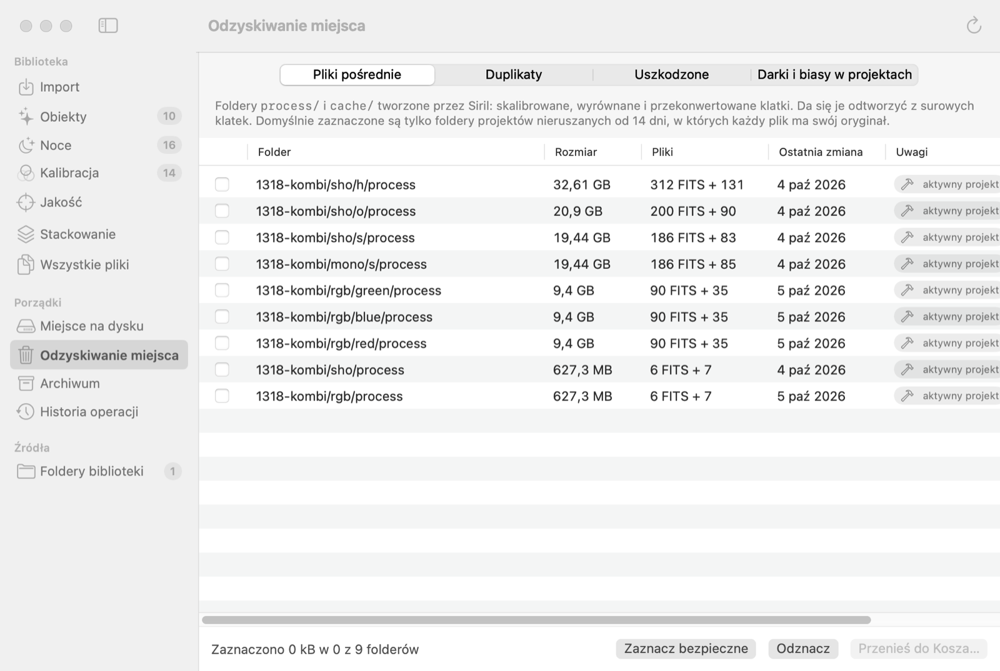

# DeepSkyShelf

**A Mac app that keeps your astrophotography library in order.** It catalogs your FITS frames, checks calibration and frame quality, prepares stacking folders for Siril, PixInsight WBPP and AstroWizard, and frees up disk space safely.

The app is in Polish. [Opis po polsku ↓](#po-polsku)

## What it does

- **Catalog.** Reads the FITS headers in your library folder and shows targets, nights, filters and integration time. Projects that point at the same place in the sky (e.g. `1318-kombi` and `NGC 6910`) become one target.
- **Import.** Copies new nights from ASIAIR (over the network), Seestar (USB) or a USB stick into Target / Night / Filter folders and verifies every copy. Darks and biases go to a shared calibration library. Nothing is deleted from the device.
- **Calibration.** Matches darks, flats and biases to every series of lights (camera, gain, offset, temperature, exposure, filter, rotation) and lists what is missing.
- **Frame quality.** Counts the stars on every frame, measures how sharp they are, and compares the frame with clear nights on the same target. Frames with haze, clouds, an obstruction or blur are marked with the cause and time. Each night gets one verdict: how many frames and hours you can use. Your own decisions always win.
- **Stacking prep.** Builds a ready folder for Siril (the AstroBBQ scripts that come with Siril, or a generated script), PixInsight WBPP or AstroWizard, without the rejected frames. It uses hard links, so it takes no extra disk space. Siril can be started straight from the app.
- **Reclaiming space.** Finds Siril working folders (`process/`, `cache/`), duplicates, damaged files and darks/biases copied into project folders. You always see the list first. Files go to the Trash and can be put back.
- **Archive.** Copies finished projects to a NAS or to S3-compatible cloud storage (e.g. Backblaze B2), verifies every file, and can then move the local copies to the Trash. Projects can be restored from the archive.

| Targets | Calibration | Reclaiming space |
|---|---|---|
|  |  |  |

## Requirements

- A Mac with Apple silicon (M1 or newer) and macOS 14 Sonoma or newer.
- For stacking: [Siril](https://siril.org) in Applications. PixInsight and AstroWizard are optional.

## Installation

1. Download `DeepSkyShelf-….zip` from [Releases](../../releases) and double-click it to unzip.
2. Drag **DeepSkyShelf** to Applications and open it.
3. macOS says it cannot verify the app, because it is not notarized by Apple. Click **Done**.
4. Open **System Settings → Privacy & Security**, scroll down and click **Open Anyway** next to DeepSkyShelf.

## Getting started

1. Click **Dodaj folder…** (Add folder) and choose the folder with your frames, e.g. `~/Pictures/Asiair`. The scan only reads file headers.
2. Browse **Obiekty** (targets) and **Noce** (nights). Frame quality is measured in the background.
3. **Kalibracja** (calibration) shows which darks, flats or biases are missing.
4. Open a target and click **Przygotuj do stackowania** (prepare for stacking).

## Safety and privacy

- Your original frames are never changed. The app writes files only when you start an action: import, stacking folder, archive or cleanup.
- Nothing is deleted permanently. Cleanup and archive move files to the Trash, and **Historia operacji** (history) can undo them.
- Everything runs on your Mac: no account, no tracking. The app goes online only for a cloud archive you set up, and the cloud key is kept in the macOS Keychain.
- The catalog lives in `~/Library/Application Support/DeepSkyShelf`. To uninstall, delete the app and that folder.
- This is a beta. Back up your library before cleaning it up.

## License

Freeware, © 2026 vagari.it. Free to use and to share unchanged. Selling and modifying are not allowed. Provided without warranty. See [LICENSE](LICENSE).

## Feedback

Report bugs and ideas in [Issues](../../issues).

---

## Po polsku

**Aplikacja na Maca, która porządkuje bibliotekę astrofotografii.** Kataloguje klatki FITS, sprawdza kalibrację i jakość klatek, przygotowuje foldery do stackowania w Siril, PixInsight WBPP i AstroWizard oraz bezpiecznie odzyskuje miejsce na dysku.

### Co robi

- **Katalog.** Czyta nagłówki FITS z folderu biblioteki i pokazuje obiekty, noce, filtry i czas naświetlania. Projekty z tym samym miejscem na niebie (np. `1318-kombi` i `NGC 6910`) łączy w jeden obiekt.
- **Import.** Kopiuje nowe noce z ASIAIR (przez sieć), Seestara (USB) albo pendrive'a do folderów Obiekt / Noc / Filtr i sprawdza każdą kopię. Darki i biasy trafiają do wspólnej biblioteki kalibracji. Z urządzenia nic nie jest usuwane.
- **Kalibracja.** Dopasowuje darki, flaty i biasy do każdej serii lightów (kamera, gain, offset, temperatura, czas, filtr, kąt obrotu) i pokazuje, czego brakuje.
- **Jakość klatek.** Liczy gwiazdy na każdej klatce, mierzy ich ostrość i porównuje z czystymi nocami nad tym samym obiektem. Klatki z mgłą, chmurami, przeszkodą albo rozmyte oznacza z przyczyną i godziną. Każda noc dostaje jedną ocenę: ile klatek i godzin się przyda. Twoje decyzje zawsze mają pierwszeństwo.
- **Przygotowanie do stackowania.** Tworzy gotowy folder dla Siril (skrypty AstroBBQ dołączone do Siril albo wygenerowany skrypt), PixInsight WBPP lub AstroWizard, bez odrzuconych klatek. Używa hard linków, więc nie zajmuje dodatkowego miejsca. Siril można uruchomić prosto z aplikacji.
- **Odzyskiwanie miejsca.** Znajduje foldery robocze Siril (`process/`, `cache/`), duplikaty, uszkodzone pliki oraz darki i biasy skopiowane do projektów. Zawsze najpierw pokazuje listę. Pliki trafiają do Kosza i można je przywrócić.
- **Archiwum.** Kopiuje skończone projekty na NAS albo do chmury zgodnej z S3 (np. Backblaze B2), sprawdza każdy plik i może potem przenieść lokalne kopie do Kosza. Projekty można przywrócić z archiwum.

### Wymagania

- Mac z procesorem Apple (M1 lub nowszy), macOS 14 Sonoma lub nowszy.
- Do stackowania: [Siril](https://siril.org) w folderze Programy. PixInsight i AstroWizard są opcjonalne.

### Instalacja

1. Pobierz `DeepSkyShelf-….zip` z [Releases](../../releases) i rozpakuj go podwójnym kliknięciem.
2. Przeciągnij **DeepSkyShelf** do folderu Programy i uruchom.
3. macOS napisze, że nie może sprawdzić programu, bo nie jest notaryzowany przez Apple. Kliknij **Gotowe**.
4. Otwórz **Ustawienia systemowe → Prywatność i ochrona**, przewiń w dół i kliknij **Otwórz mimo to** przy DeepSkyShelf.

### Pierwsze kroki

1. Kliknij **Dodaj folder…** i wybierz folder z klatkami, np. `~/Pictures/Asiair`. Skanowanie tylko czyta nagłówki plików.
2. Przejrzyj **Obiekty** i **Noce**. Jakość klatek jest mierzona w tle.
3. **Kalibracja** pokazuje, których darków, flatów albo biasów brakuje.
4. Otwórz obiekt i kliknij **Przygotuj do stackowania**.

### Bezpieczeństwo i prywatność

- Oryginalne klatki nigdy nie są zmieniane. Aplikacja zapisuje pliki tylko wtedy, gdy sam uruchomisz akcję: import, folder do stackowania, archiwizację albo porządki.
- Nic nie jest usuwane na stałe. Porządki i archiwum przenoszą pliki do Kosza, a **Historia operacji** pozwala je cofnąć.
- Wszystko działa na Twoim Macu: bez konta i bez śledzenia. Aplikacja łączy się z internetem tylko przy archiwum w chmurze, które sam ustawisz, a klucz do chmury trzyma w pęku kluczy macOS.
- Katalog jest w `~/Library/Application Support/DeepSkyShelf`. Żeby odinstalować, usuń aplikację i ten folder.
- To wersja testowa. Przed porządkami zrób kopię zapasową biblioteki.

### Licencja

Freeware, © 2026 vagari.it. Za darmo do używania i przekazywania dalej bez zmian. Nie wolno sprzedawać ani przerabiać. Bez gwarancji. Szczegóły w pliku [LICENSE](LICENSE).

### Uwagi i błędy

Zgłaszaj w zakładce [Issues](../../issues).
